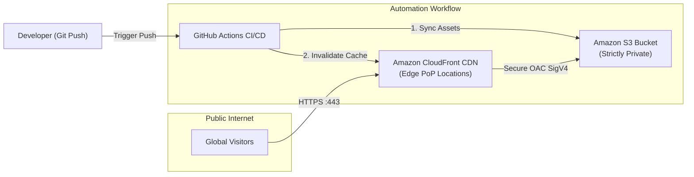

# Serverless Static Website Hosting with CI/CD on AWS

[](https://www.terraform.io/)
[](https://aws.amazon.com/s3/)
[](https://aws.amazon.com/cloudfront/)
[](https://github.com/features/actions)

---

## 📌 Project Overview

This project implements a secure, highly available, and cost-efficient **Serverless Static Website Hosting Platform** on AWS using **Terraform (Infrastructure as Code)** and **GitHub Actions**.

Rather than running compute-heavy virtual machines (EC2) to host static web content, this architecture uses:
1. **Amazon S3** as a private object storage origin.
2. **Amazon CloudFront** as a global Content Delivery Network (CDN) with modern **Origin Access Control (OAC)**.
3. **GitHub Actions** to automate deployments on every Git commit with instant edge cache invalidation.



---

## ✨ Key Highlights

- **Infrastructure as Code (IaC):** Fully automated provisioning of S3 buckets, CloudFront CDN distribution, and IAM policies using Terraform.
- **Modern Security Architecture:** Origin Access Control (OAC) ensures that only CloudFront can read from the S3 bucket via SigV4 signing. All direct public access is blocked.
- **Automated CI/CD Pipeline:** GitHub Actions workflow automatically syncs updated static assets to S3 and triggers a CloudFront cache invalidation on every push.
- **High Performance & Low Latency:** Edge caching across AWS Points of Presence (PoPs) provides global sub-50ms response times.
- **Zero Idle Compute Costs:** Operating entirely serverless eliminates VM maintenance and runs within the AWS Free Tier.

---

## 📁 Repository Structure

```text
aws-serverless-static-website-cicd/
├── website/                             # Static Web Application Source
│   ├── index.html                       # Responsive HTML5 landing page
│   ├── error.html                       # Custom 404 error page
│   ├── style.css                        # Modern CSS styling
│   └── app.js                           # Interactive edge latency telemetry
├── terraform/                           # Infrastructure as Code (IaC)
│   ├── main.tf                          # S3 bucket, CloudFront distribution, OAC, bucket policy
│   ├── variables.tf                     # Configurable inputs (region, project name)
│   ├── outputs.tf                       # CloudFront URL, S3 bucket name, distribution ID
│   ├── versions.tf                      # AWS provider (~> 5.0) requirements
│   └── terraform.tfvars.example         # Sample variable values
├── .github/
│   └── workflows/
│       └── deploy.yml                   # Automated GitHub Actions sync & invalidation workflow
├── scripts/                             # Automation helper scripts
│   ├── deploy-infra.sh                  # Terraform apply runner
│   ├── destroy-infra.sh                 # Safe teardown runner
│   └── sync-manual.sh                   # Manual CLI deploy script
├── .gitignore
└── README.md                            # Project documentation
```

---

## 🔒 Security Architecture: Origin Access Control (OAC)

Directly exposing an S3 bucket to the public internet using public read policies is a security vulnerability. This project follows AWS security best practices:

* **S3 Block Public Access:** All 4 public access block settings (`block_public_acls`, `block_public_policy`, `ignore_public_acls`, `restrict_public_buckets`) are enabled.
* **Origin Access Control (OAC):** Uses AWS SigV4 request signing to restrict S3 bucket reads strictly to the provisioned CloudFront distribution ARN.
* **HTTPS Enforcement:** CloudFront automatically redirects any insecure `http://` requests to secure `https://` with TLS 1.2+.

---

## 🚀 Deployment Guide

### Prerequisites
- [AWS CLI v2](https://docs.aws.amazon.com/cli/latest/userguide/install-cliv2.html) installed and configured (`aws configure`).
- [Terraform](https://www.terraform.io/downloads.html) installed (>= 1.5.0).

### 1. Provision Infrastructure
```bash
cd terraform

# Initialize providers
terraform init

# Review execution plan
terraform plan

# Provision S3 and CloudFront
terraform apply -auto-approve
```

Terraform outputs the following upon completion:
- `s3_bucket_name`: Name of the private S3 bucket
- `cloudfront_distribution_id`: ID of the CloudFront distribution
- `cloudfront_domain_name`: Public HTTPS URL of the CloudFront endpoint

### 2. Upload Website Files
You can upload the static assets using the helper script:
```bash
cd ..
./scripts/sync-manual.sh <S3_BUCKET_NAME> <CLOUDFRONT_DIST_ID>
```
Or view the site by visiting the `cloudfront_domain_name` URL in your browser.

---

## 🔄 Automated CI/CD Workflow (GitHub Actions)

The repository includes a GitHub Actions pipeline (`.github/workflows/deploy.yml`) that executes on every push to `main`:

1. **Asset Sync:** Automatically synchronizes the `website/` directory to the target S3 bucket with optimized `Cache-Control` headers.
2. **Cache Invalidation:** Creates an instant CloudFront invalidation (`/*`) so updates reflect across all global edge locations immediately.

### Required GitHub Secrets
To enable the automated pipeline, configure these secrets under **Settings > Secrets and variables > Actions**:

| Secret Name | Description |
| :--- | :--- |
| `AWS_ACCESS_KEY_ID` | AWS IAM Access Key ID |
| `AWS_SECRET_ACCESS_KEY` | AWS IAM Secret Access Key |
| `AWS_REGION` | Target AWS Region (e.g., `us-east-1`) |
| `S3_BUCKET_NAME` | Value from Terraform output `s3_bucket_name` |
| `CLOUDFRONT_DIST_ID` | Value from Terraform output `cloudfront_distribution_id` |

---

## 💡 Architecture & Design FAQs

### Why S3 and CloudFront over an EC2 instance?
Static websites (HTML, CSS, JS) do not require a dedicated backend server runtime. Using S3 with CloudFront delivers 99.99% availability, zero OS patching or server maintenance, global edge distribution, and near-zero cost under the AWS Free Tier.

### How does cache invalidation work in the pipeline?
CloudFront caches content at edge locations based on TTL headers. When new assets are pushed to S3, edge servers would otherwise serve stale files until the cache expires. The pipeline executes `aws cloudfront create-invalidation --paths '/*'` to refresh edge nodes immediately.

### Why use OAC instead of legacy OAI (Origin Access Identity)?
OAI is AWS's legacy mechanism that does not support all modern features or SSE-KMS encryption. Origin Access Control (OAC) is the current AWS standard that supports SigV4 signing, custom header forwarding, and enhanced security policies.

### How are 404 errors handled?
The CloudFront distribution is configured with custom error responses for HTTP 403 and 404 status codes, serving a custom `error.html` page smoothly without exposing raw XML errors.

---

## 🧹 Infrastructure Teardown

To clean up all provisioned AWS resources and avoid unnecessary charges:

```bash
cd terraform
terraform destroy -auto-approve
```
